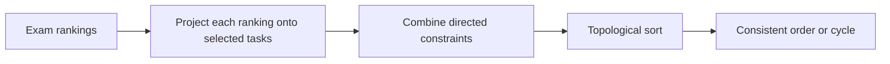

# Algorithm notes

This guide describes the maintained Python files. The 2024 TeX/PDF reports are
historical documents; their claims and embedded listings have not been rewritten
as if the later maintenance work were part of the original submission.

## Task 2 — Schwierigkeiten

Each exam supplies a ranked chain of tasks. First project that chain onto the
selected tasks, preserving their relative order. Add directed edges between
consecutive tasks in the projected chain. Combine the edges from all exams.

For example, selecting `A` and `B` from `A < X < B` must produce `A < B`. The
original parser filtered adjacent pairs individually and lost this constraint;
the maintained parser filters the chain before constructing its edges.

Kahn's topological-sort algorithm repeatedly removes a task with zero incoming
edges. A min-heap chooses the lexicographically smallest available task, making
output reproducible even when several orders satisfy the constraints. Duplicate
edges are removed, and sorting does not mutate the caller's indegree map.
If selected nodes remain after the heap empties, their combined constraints
contain a cycle and the program reports `NO GOOD ORDERING POSSIBLE`.

Let `L` be the number of task tokens read, `V` the selected task count, and `E`
the distinct projected edges. Graph construction and sorting take
`O(L + E + V log V)` operations, with `O(V + E)` graph storage, apart from the
input text. This assumes constant-cost comparisons of task labels.

Supported exam lines are single chains separated by `<`. Comparisons involving
unselected tasks are projected within each original exam, rather than requiring
a topological ordering of every task in the source data. The competition example
has a conflict involving an unselected task but still permits an ordering of its
selection; sorting the whole unfiltered graph would incorrectly reject it.

## Task 3 — Wandertag

A member participates when at least one chosen length falls inside that member's
inclusive interval. Counting each member once is essential: adding the coverage
of each route independently would double-count overlaps.

The original approach is retained:

1. Collect all distinct start/end points as candidates.
2. Rank them by individual coverage; ties prefer the larger endpoint.
3. Keep the first 60 by default.
4. Examine three-point combinations and retain the first best result.
5. Stop early if every member is covered.

Membership is cached as one integer bit mask per endpoint. A triple's union is
computed with bitwise OR, and `int.bit_count()` counts its covered members.
This replaces repeated per-member scans without changing the scoring objective.
The CLI prints each route's members and the deduplicated total.

### Heuristic versus exhaustive mode

The top 60 individual candidates need not contain the best *joint* triple.
A crowded cluster can occupy the cap and displace a route serving a separate
group. The command explicitly reports `capped heuristic` whenever endpoints
were excluded. There is no approximation-ratio claim.

`--candidate-limit 0` uses every endpoint. Restricting a full search to endpoints
is sufficient for coverage: any chosen point serving a group of intervals can
be moved to a boundary of their common intersection without losing that group.
Searching every endpoint triple therefore maximizes coverage for this integer
interval model. This is a finite exhaustive search, not a claim that the capped
mode is exact.

With fewer than three candidates, the program returns the available distinct
lengths; it does not invent redundant extra routes. This handles tiny inputs,
including a single zero-width interval.

Let `N` be members, `M <= 2N` distinct endpoints, and `C` retained candidates.
There are at most `binomial(C, 3)` triples: **34,220** at the default cap of 60.
Mask construction examines `M × N` memberships. Each triple operates on
`N`-bit integers; the bit operations grow with that bit width rather than being
constant-cost for arbitrarily large inputs. Cached masks use `O(MN)` bits,
plus input and container overhead. Combinations are streamed, not materialized.
Exact mode can be very expensive on large datasets.

## Task 5 — Das ägyptische Grabmal

A section with period `p` is open during half-open intervals
`[(2k + 1)p, (2k + 2)p)`. Equivalently, it is open at time `t` exactly when
`floor(t / p)` is odd. The model assumes instantaneous movement between open
adjacent sections.

The solver keeps the original forward/backtracking approach:

- Enter the first section when it first opens.
- If the next section is open, advance at the current time.
- Otherwise wait for its next opening only if the current section remains open.
- If waiting there is unsafe, revise an earlier section's entry to a later
  opening and resume the forward search.

The returned list contains one entry time per section. Instructions collapse
instantaneous moves when possible. For periods `5, 8, 12`, entry times are
`5, 8, 12`, reaching the tomb after 12 minutes. Entering the corridor at minute 8
instead is another way to reach the same arrival time.

This pass makes the search importable, passes periods explicitly instead of
sharing mutable module state, handles one-section inputs, and caps outer search
iterations with `--max-steps`. Reaching the cap is an error with an actionable
message, **not** a proof that no solution exists.

A forward/backtrack iteration can inspect or copy up to `N` section entries.
For `S` outer iterations, `O(SN)` is a useful upper bound on these operations,
with `O(N)` path state, ignoring integer-arithmetic costs. The number of search
iterations depends on the periods and backtracking; this guide does not assert
a polynomial bound in the input bit length or a general optimality proof.

## What is verified

The tests run offline and include:

- A ranking that must preserve `Z < A` through an omitted middle task.
- A conflicting ranking and deterministic, repeatable sorting.
- Coverage with overlapping and zero-width intervals.
- Fifty seeded small hiking instances checked against a separate integer-grid
  brute-force search in exhaustive mode.
- A deliberately limited candidate pool that loses coverage.
- All 117 sequences of lengths 2–4 with periods drawn from `{1, 2, 3}`,
  compared with a discrete-time reachability search. Entry times are also
  checked for safe waits and open sections.
- The tomb report's `20, 10, 4, 7` case, a single section, and the work-limit error.
- CLI examples, missing inputs, and imports without output/network access.

Passing these checks is evidence on these cases. It is not a substitute for a
proof or a run over every official competition input. Historical runtime values
in the original reports are not presented as new benchmarks.
